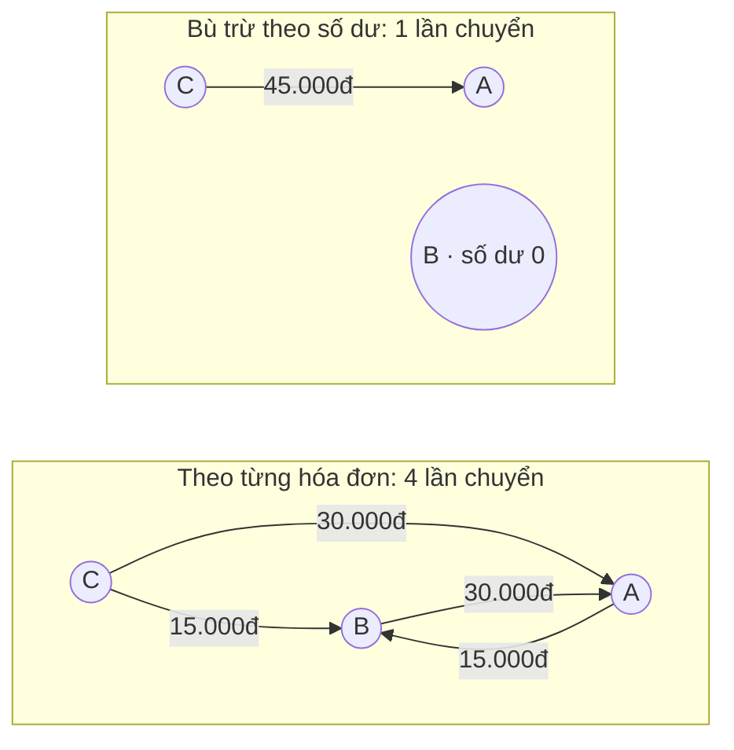
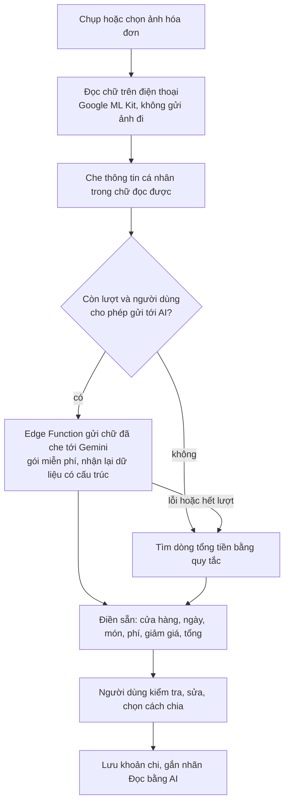

# Đặc tả nghiệp vụ — Quy tắc tất toán công nợ tối thiểu số lần chuyển

20/10/2026 · Business Analyst · Cập nhật 21/10/2026

## 1. Thông tin tài liệu

Tài liệu này thay thế mục 5 "Quy tắc tính toán công nợ" trong Đặc tả nghiệp vụ MVP v1.0. Mục tiêu: mỗi thành viên tất toán với số lần chuyển tiền ít nhất trong một nhóm.

| Mục | Nội dung |
| --- | --- |
| Tài liệu gốc | Đặc tả nghiệp vụ MVP — Split Bill App v1.0 |
| Phiên bản | 1.1 — bổ sung, thay thế mục 5 của v1.0 |
| Vai trò soạn thảo | Business Analyst |
| Trạng thái | Dự thảo, chờ Product Owner phê duyệt |
| Người đọc | Product Owner, Backend (Supabase), Mobile (React Native + Expo), QA |
| Phạm vi áp dụng | Tính công nợ và gợi ý tất toán trong một nhóm, đơn vị VND. App mobile viết bằng React Native + Expo, thay cho Android native trong v1.0. Backend dùng Supabase, thay cho NestJS + Prisma |
| Kế hoạch code | [DEV_SplitBill_KeHoachCode_v2.0.md](DEV_SplitBill_KeHoachCode_v2.0.md) |

**Lịch sử phiên bản**

| Phiên bản | Ngày | Thay đổi |
| --- | --- | --- |
| 1.1 | 20/10/2026 | Thêm quy tắc số dư ròng, gợi ý tất toán tối thiểu số lần chuyển, xử lý thanh toán chờ xác nhận; chuyển app mobile sang React Native + Expo; backend chuyển sang Supabase; thêm đọc hóa đơn bằng AI (mục 10, ngày 22/10/2026) |
| 1.0 | — | Đặc tả MVP gốc |

## 2. Bối cảnh và vấn đề nghiệp vụ

Nếu tính công nợ theo từng hóa đơn, một nhóm 3 người đi 2 bữa đã phải chuyển tiền 4 lần. Quy tắc bù trừ theo số dư cả nhóm đưa con số này về 1 lần.

**Tình huống:** nhóm A, B, C đi ăn 2 bữa. A trả bữa thứ nhất 90.000đ (30.000đ/người). B trả bữa thứ hai 45.000đ (15.000đ/người). C chưa trả bữa nào.

| Cách tính | Các lần chuyển | Số lần |
| --- | --- | --- |
| Theo từng hóa đơn | C→A 30.000đ, C→B 15.000đ, B→A 30.000đ, A→B 15.000đ | 4 |
| Bù trừ từng cặp người | C→A 30.000đ, C→B 15.000đ, B→A 15.000đ | 3 |
| Bù trừ theo số dư cả nhóm (đề xuất) | C→A 45.000đ | 1 |



B vừa nhận 30.000đ vừa trả 30.000đ nên số dư bằng 0; sau bù trừ chỉ còn C chuyển A 45.000đ.

**Vấn đề cần giải quyết:**

- Người dùng phải chuyển nhiều lần, tốn công và dễ nhầm số tiền.
- A và B chuyển qua lại cho nhau, dù cuối cùng B không nợ ai và cũng không được ai nợ.
- Càng nhiều lần chuyển, càng nhiều yêu cầu xác nhận thanh toán và nguy cơ tranh chấp.

## 3. Đánh giá khoảng trống của đặc tả v1.0

Công thức "Chênh lệch = Tổng đã trả − Tổng phần phải chịu" ở mục 5 là nền đúng, nhưng chưa đủ để đội phát triển cài đặt. Phần thiếu lớn nhất: không có quy tắc xác định ai chuyển cho ai.

| Mã | Hiện trạng v1.0 | Khoảng trống | Rủi ro nếu giữ nguyên | Xử lý tại |
| --- | --- | --- | --- | --- |
| G-01 | Mục 5 chỉ tính từ khoản chi | Chưa nêu thanh toán làm số dư thay đổi theo chiều nào | Mỗi bên cài đặt một kiểu, số liệu lệch nhau | BR-01 |
| G-02 | DEBT-01 ghi "ai nợ ai" | Chưa có quy tắc xác định người nhận tiền | Đội phát triển tính theo từng hóa đơn, sinh nhiều lần chuyển | BR-03, BR-04 |
| G-03 | PAY-03 chỉ trừ khoản đã xác nhận | Chưa nói khoản đang chờ xác nhận ảnh hưởng gợi ý thế nào | App tiếp tục gợi ý trả, người dùng chuyển trùng | BR-06 |
| G-04 | PAY-01 có người nhận | Chưa nói người dùng có được trả người khác với gợi ý hay không | Chặn các cách trả hợp lệ hoặc tính sai | BR-07 |
| G-05 | Mục 5 yêu cầu giải thích được số nợ | Chưa nói cách giải thích khi đã bù trừ | C thắc mắc vì sao trả A mà không trả B | BR-08 |
| G-06 | EXP-02 có quy tắc làm tròn | Chưa ràng buộc tổng số dư cả nhóm | Sai lệch vài đồng tích lũy không ai phát hiện | BR-02 |
| G-07 | GRP-05 cảnh báo khi còn công nợ | Chưa định nghĩa "còn công nợ" khi đã bù trừ | Thành viên rời nhóm khi còn khoản chờ xác nhận | BR-11 |

## 4. Quy tắc nghiệp vụ

Công nợ được tính từ số dư ròng của từng thành viên trong nhóm, không tính theo từng hóa đơn. Từ số dư đó, hệ thống đưa ra gợi ý tất toán với số lần chuyển ít nhất.

### BR-01. Số dư ròng

```latex
\text{Số dư}(u) = \sum \text{khoản chi } u \text{ đã trả} - \sum \text{phần } u \text{ phải chịu} + \sum \text{thanh toán } u \text{ đã gửi} - \sum \text{thanh toán } u \text{ đã nhận}
```

- Chỉ tính khoản chi ở trạng thái hợp lệ. Khoản chi đã hủy không được tính.
- Số dư dương: được nhận lại. Số dư âm: phải trả. Bằng 0: đã cân bằng.
- **Số dư chính thức** chỉ tính thanh toán đã xác nhận. **Số dư dự kiến** tính thêm thanh toán đang chờ xác nhận (BR-06).

### Danh mục quy tắc

| Mã | Quy tắc | Ghi chú |
| --- | --- | --- |
| BR-02 | Mọi số tiền là số nguyên VND. Tổng số dư của cả nhóm luôn bằng 0. | Nếu khác 0: ghi log lỗi, không hiển thị gợi ý, không tự bù chênh lệch. |
| BR-03 | Công nợ hiển thị là gợi ý tất toán, tính lại từ số dư mỗi khi dữ liệu thay đổi. | Không lưu bảng nợ theo cặp người, đúng nguyên tắc mục 4.5 của v1.0. |
| BR-04 | Gợi ý tất toán phải có số lần chuyển ít nhất để đưa mọi số dư về 0. | Thuật toán ở bên dưới. |
| BR-05 | Cùng một bộ số dư luôn cho cùng một gợi ý. | Khi hai người có số tiền bằng nhau, xếp theo mã người dùng. Gợi ý không đổi khi tải lại màn hình. |
| BR-06 | Gợi ý tất toán tính trên số dư dự kiến. Công nợ chính thức tính trên số dư chính thức. | Khoản đang chờ hiển thị riêng: "Đang chờ A xác nhận". Bị từ chối hoặc báo sai lệch thì gợi ý xuất hiện lại. |
| BR-07 | Người dùng được trả cho bất kỳ thành viên nào trong nhóm, không bắt buộc theo gợi ý. | Số dư tự cân lại. Cảnh báo khi số tiền vượt mức gợi ý. |
| BR-08 | Mỗi gợi ý phải giải thích được nguồn gốc từ các khoản chi gốc. | Ví dụ: "30.000đ bữa trưa (A trả) + 15.000đ cà phê (B trả), phần B ứng đã bù trừ qua A". |
| BR-09 | Mỗi nhóm có công tắc "Đơn giản hóa công nợ", mặc định bật. | Khi tắt: chỉ bù trừ từng cặp người, ai ứng tiền thì nhận đúng phần của mình. |
| BR-10 | Bù trừ chỉ diễn ra trong một nhóm. | Home cộng gộp theo từng nhóm, không bù trừ giữa các nhóm. |
| BR-11 | Thành viên chỉ rời nhóm, nhóm chỉ đóng được khi số dư chính thức bằng 0 và không còn thanh toán đang chờ. | Bổ sung cho GRP-05, GRP-06. |

### Thuật toán gợi ý tất toán (BR-04)

1. Bỏ các thành viên có số dư dự kiến bằng 0.
2. Chia những người còn lại thành nhiều nhóm con nhất có thể, mỗi nhóm con có tổng số dư bằng 0.
3. Trong mỗi nhóm con, người nợ nhiều nhất chuyển cho người được nhận nhiều nhất, số tiền bằng mức nhỏ hơn trong hai bên. Lặp lại đến khi hết.
4. Nhóm có hơn 20 người còn số dư: ghép trước các cặp nợ và có bằng nhau, phần còn lại chạy bước 3. Kết quả gần tối ưu, tối đa n − 1 lần chuyển.

Số lần chuyển tối thiểu = số người còn số dư − số nhóm con ở bước 2. Không được chỉ dùng bước 3 cho cả nhóm, vì cách đó có thể sinh thêm lần chuyển (ví dụ 3 ở mục 6).

## 5. User stories và tiêu chí nghiệm thu

Sáu user story dưới đây bao phủ toàn bộ quy tắc ở mục 4. QA dùng trực tiếp các tiêu chí Given/When/Then làm test case.

**US-01 — Xem gợi ý tất toán** (BR-03, BR-04, BR-05)

Là thành viên nhóm, tôi muốn biết mình cần chuyển cho ai và bao nhiêu, để trả xong với ít lần chuyển nhất.

- AC-01.1: **Given** tình huống ở mục 2. **When** C mở Tổng quan công nợ. **Then** C thấy đúng một gợi ý "Chuyển A 45.000đ", còn B thấy "Bạn đã cân bằng".
- AC-01.2: **Given** số dư +40.000đ, +30.000đ, −20.000đ, −20.000đ, −30.000đ. **When** hệ thống tính gợi ý. **Then** có đúng 3 lần chuyển.
- AC-01.3: **Given** một bộ gợi ý bất kỳ. **When** mọi lần chuyển được thực hiện và xác nhận. **Then** số dư mọi thành viên bằng 0.
- AC-01.4: **Given** cùng dữ liệu. **When** tải lại màn hình nhiều lần. **Then** gợi ý không đổi.

**US-02 — Hiểu vì sao phải trả người này** (BR-08)

Là người phải trả, tôi muốn biết vì sao mình trả A mà không trả B, để tin số tiền là đúng.

- AC-02.1: **Given** C có gợi ý "Chuyển A 45.000đ". **When** C mở Chi tiết công nợ. **Then** C thấy danh sách khoản chi gốc với phần của mình (30.000đ + 15.000đ), kèm câu giải thích phần B ứng đã được bù trừ qua A.

**US-03 — Không bị gợi ý trả lại khoản đã gửi** (BR-06)

Là người đã chuyển tiền, tôi muốn app không nhắc tôi trả lại trong lúc chờ người nhận xác nhận.

- AC-03.1: **Given** C đã gửi yêu cầu xác nhận 45.000đ cho A. **When** C mở Tổng quan công nợ. **Then** gợi ý chuyển biến mất, thay bằng "Đang chờ A xác nhận 45.000đ". Công nợ chính thức của C vẫn là −45.000đ.
- AC-03.2: **Given** A từ chối hoặc báo sai lệch. **When** hệ thống cập nhật. **Then** gợi ý "Chuyển A 45.000đ" xuất hiện lại và C nhận thông báo.

**US-04 — Xác nhận đã nhận tiền** (BR-01, PAY-04)

Là người nhận, tôi muốn xác nhận khoản tiền để công nợ được cập nhật đúng một lần.

- AC-04.1: **Given** B đã gửi 200.000đ cho A. **When** A xác nhận. **Then** số dư chính thức của B tăng 200.000đ, của A giảm 200.000đ.
- AC-04.2: **Given** A đã xác nhận. **When** yêu cầu xác nhận được gửi lại (mất mạng, bấm hai lần). **Then** số dư không thay đổi thêm.

**US-05 — Tắt đơn giản hóa công nợ** (BR-09)

Là chủ nhóm, tôi muốn tắt bù trừ, để ai ứng tiền thì nhận đúng phần của mình.

- AC-05.1: **Given** tình huống ở mục 2 và công tắc tắt. **When** hệ thống tính gợi ý. **Then** gợi ý là C→A 30.000đ, C→B 15.000đ, B→A 15.000đ.

**US-06 — Gợi ý cập nhật khi khoản chi thay đổi** (BR-03, EXP-06, EXP-07)

Là thành viên nhóm, tôi muốn gợi ý luôn khớp với các khoản chi hiện tại.

- AC-06.1: **Given** gợi ý đang là C→A 45.000đ. **When** khoản chi của B bị hủy. **Then** gợi ý mới là B→A 30.000đ và C→A 30.000đ; B và C nhận thông báo.

## 6. Ví dụ tính toán

Ba ví dụ dưới đây đã được kiểm chứng bằng bản cài đặt tham khảo. Ví dụ nào cũng có tổng số dư bằng 0.

### Ví dụ 1 — Tình huống A, B, C ở mục 2

| Thành viên | Đã trả | Phần phải chịu | Số dư | Gợi ý |
| --- | --- | --- | --- | --- |
| A | 90.000đ | 45.000đ | +45.000đ | Nhận 45.000đ từ C |
| B | 45.000đ | 45.000đ | 0đ | Không phải chuyển |
| C | 0đ | 45.000đ | −45.000đ | Chuyển A 45.000đ |

### Ví dụ 2 — Thanh toán một phần và đang chờ xác nhận

A trả hóa đơn 900.000đ, chia đều 3 người. B đã chuyển A 200.000đ và A đã xác nhận. C đã gửi yêu cầu xác nhận 300.000đ, A chưa xác nhận.

| Thành viên | Số dư chính thức | Số dư dự kiến | Hiển thị |
| --- | --- | --- | --- |
| A | +400.000đ | +100.000đ | Cần thu 400.000đ, trong đó 300.000đ chờ bạn xác nhận |
| B | −100.000đ | −100.000đ | Chuyển A 100.000đ |
| C | −300.000đ | 0đ | Đang chờ A xác nhận 300.000đ |

### Ví dụ 3 — Vì sao cần tách nhóm con (bước 2 của thuật toán)

Số dư: A +40.000đ, B +30.000đ, C −20.000đ, D −20.000đ, E −30.000đ.

| Cách làm | Các lần chuyển | Số lần |
| --- | --- | --- |
| Chỉ dùng bước 3 cho cả nhóm | E→A 30.000đ, C→B 20.000đ, D→A 10.000đ, D→B 10.000đ | 4 |
| Tách nhóm con {A, C, D} và {B, E} | C→A 20.000đ, D→A 20.000đ, E→B 30.000đ | 3 |

Kiểm thử 3.000 bộ số dư ngẫu nhiên (nhóm 2–8 người) cho thấy cách chỉ dùng bước 3 sinh thừa lần chuyển ở 110 bộ (khoảng 3,7%). Thuật toán đầy đủ cho kết quả tối ưu ở cả 3.000 bộ.

## 7. Tác động tới đặc tả v1.0

Thay đổi chủ yếu nằm ở màn công nợ và luồng thanh toán. Mô hình dữ liệu chỉ thêm hai trường, không thêm bảng.

### Màn hình và yêu cầu

| Hạng mục v1.0 | Thay đổi |
| --- | --- |
| DEBT-01 Tổng quan công nợ | Hiển thị gợi ý tất toán thay cho "ai nợ ai theo hóa đơn". Tách công nợ chính thức và khoản đang chờ xác nhận. |
| DEBT-02 Chi tiết công nợ | Thêm phần giải thích nguồn gốc theo BR-08. |
| PAY-01 Ghi nhận thanh toán | Mở từ gợi ý thì điền sẵn người nhận và số tiền, cho phép sửa. Cảnh báo khi vượt mức gợi ý. |
| PAY-02 Xác nhận thanh toán | Sau khi xác nhận, từ chối hoặc báo sai lệch: tính lại gợi ý cho cả nhóm. |
| HOME-01 Home | "Cần thu" và "cần trả" là tổng số dư chính thức của từng nhóm, không bù trừ giữa các nhóm. |
| GRP-03 Tạo, chỉnh sửa nhóm | Thêm công tắc "Đơn giản hóa công nợ". |
| GRP-05, GRP-06 Rời, đóng nhóm | Áp dụng điều kiện BR-11. |
| NOTI-01 Thông báo | Thông báo khi gợi ý của người dùng thay đổi vì khoản chi mới, sửa, hủy hoặc thanh toán bị từ chối. |
| Mục 7 Tiêu chí hoàn thành | Thêm: "Gợi ý tất toán có số lần chuyển tối thiểu và tổng số dư nhóm luôn bằng 0". |

### Dữ liệu và API

| Đối tượng | Thay đổi |
| --- | --- |
| Group | Thêm `simplify_debts` (boolean, mặc định `true`). |
| Payment | Trạng thái: PENDING, CONFIRMED, REJECTED, DISPUTED, CANCELLED. Thêm `idempotency_key` duy nhất để chống ghi trùng. Người nhận là bất kỳ thành viên nào. |
| Bảng công nợ | Không tạo. Số dư và gợi ý được tính khi đọc theo BR-03. |
| Số dư và gợi ý tất toán | View `group_balances` trả về số dư chính thức và số dư dự kiến; gợi ý tính từ số dư bằng `settlement.ts`. RLS chỉ cho thành viên nhóm đọc. |

Bản cài đặt tham khảo bằng TypeScript nằm ở [src/domain/settlement.ts](../src/domain/settlement.ts). Bộ kiểm thử sẽ được thêm vào `src/domain/` ở giai đoạn 0 của [kế hoạch code](DEV_SplitBill_KeHoachCode_v2.0.md).

### App mobile React Native + Expo

Thuật toán viết bằng TypeScript nên app Expo và Edge Function của Supabase dùng chung một mã nguồn. Số dư luôn lấy từ cơ sở dữ liệu (view `group_balances`).

| Hạng mục | Yêu cầu |
| --- | --- |
| Dùng chung logic | `computeBalances` và `simplifyDebts` là một mã nguồn TypeScript dùng chung cho app Expo và Edge Functions. Không viết lại thuật toán. |
| Nguồn số liệu hiển thị | DEBT-01 và HOME-01 lấy số dư từ view `group_balances`. Client chỉ tự tính để xem trước khi đang nhập khoản chi (EXP-02) hoặc khi mất mạng, kèm nhãn "Chưa đồng bộ". |
| Mất mạng và thao tác lặp | App tạo `idempotencyKey` ngay khi người dùng bấm lưu khoản chi hoặc gửi thanh toán. Mọi lần gửi lại dùng đúng key đó. Hàng đợi chờ gửi lưu trên máy (ví dụ expo-sqlite). |
| Số tiền | Lưu và truyền số nguyên VND, không dùng số thực. QA kiểm tra định dạng tiền trên cả iOS và Android. |
| QR tham gia nhóm, kết bạn | GRP-04, CON-02 quét mã bằng expo-camera. |
| Thông báo | NOTI-01 dùng expo-notifications. Bấm thông báo mở đúng khoản chi, nhóm hoặc yêu cầu thanh toán qua deep link của Expo Router. |
| Ảnh hóa đơn | EXP-08 dùng expo-image-picker. |
| Phát hành | File APK Android, build bằng EAS Build (profile `preview`). |

## 8. Ngoài phạm vi, rủi ro và câu hỏi mở

Còn 5 câu hỏi cần Product Owner chốt trước khi đưa vào sprint. Phần bù trừ giữa các nhóm và nhiều loại tiền để sau MVP.

**Ngoài phạm vi MVP**

- Bù trừ công nợ giữa nhiều nhóm khác nhau.
- Nhiều loại tiền trong một nhóm.
- Một khoản chi do nhiều người cùng trả.

**Rủi ro**

| Rủi ro | Ảnh hưởng | Giảm thiểu |
| --- | --- | --- |
| Người dùng không hiểu vì sao phải trả người khác với người đã ứng tiền | Khiếu nại, mất niềm tin vào số liệu | Giải thích theo BR-08, hướng dẫn ngắn ở lần đầu xem gợi ý |
| Gợi ý đổi trong lúc người dùng đang chuyển tiền | Người dùng chuyển theo số cũ | Thanh toán lưu số tiền thực tế; số dư tự cân lại theo BR-07 |
| Người nhận trong gợi ý không quen người trả | Người trả không có thông tin chuyển khoản | Hiển thị phương thức thanh toán tham chiếu của người nhận trong gợi ý |
| Nhóm trên 20 người còn số dư | Gợi ý có thể nhiều hơn mức tối ưu vài lần | Chấp nhận cho MVP, theo dõi tỷ lệ nhóm lớn sau phát hành |

**Câu hỏi mở**

- [ ] Bật sẵn "Đơn giản hóa công nợ" cho mọi nhóm mới? BA đề xuất: có.
- [ ] Ai được bật, tắt công tắc: chỉ chủ nhóm hay mọi thành viên?
- [ ] Thanh toán vượt mức gợi ý: chỉ cảnh báo hay chặn?
- [ ] Ngưỡng 20 người cho thuật toán chính xác: kiểm tra hiệu năng trên điện thoại cấu hình thấp.
- [ ] Gửi thông báo mỗi lần gợi ý thay đổi, hay chỉ khi số tiền phải trả tăng?
- [x] Nền tảng phát hành: file APK Android (đã chốt).

## 9. Kiến trúc triển khai trên Supabase

Backend dùng Supabase thay cho NestJS + Prisma. Các quy tắc ở mục 4 giữ nguyên, chỉ đổi nơi cài đặt.

| Thành phần trong đặc tả | Cài đặt trên Supabase |
| --- | --- |
| API ghi khoản chi, thanh toán, nhóm | Hàm RPC chạy trong một giao dịch, kiểm tra quyền và dữ liệu |
| Phân quyền: chỉ thành viên nhóm xem và thao tác | Row Level Security |
| Số dư chính thức và dự kiến (BR-01, BR-06) | View `group_balances`, không lưu cột số dư |
| Gợi ý tất toán (BR-04, BR-05) | `settlement.ts` trong app; Edge Function `settlements` để đối chiếu phía server |
| Nhật ký thao tác nhạy cảm | Bảng `activity_logs`, ghi trong RPC, chỉ thêm không sửa |
| Thông báo trong app và thông báo đẩy | Bảng `notifications` + Edge Function `send-push` |
| Ảnh hóa đơn, ảnh đại diện | Supabase Storage |
| Đăng nhập, thu hồi phiên | Supabase Auth |

Chi tiết bảng, hàm, màn hình và thứ tự triển khai: [DEV_SplitBill_KeHoachCode_v2.0.md](DEV_SplitBill_KeHoachCode_v2.0.md).

## 10. Đọc hóa đơn bằng AI (OCR)

Người dùng chụp hóa đơn, app đọc ra tổng tiền và từng món rồi điền sẵn vào màn thêm khoản chi. Người dùng luôn kiểm tra và sửa trước khi lưu. Chức năng này nằm trong nhóm "Để sau MVP" của v1.0, được bổ sung ngày 22/10/2026 và chỉ dùng dịch vụ miễn phí.

### 10.1. Cách hoạt động



1. Ảnh hóa đơn chỉ nằm trên điện thoại và trong Supabase Storage làm bằng chứng (EXP-08). Ảnh không được gửi tới AI.
2. Chữ đọc được trên máy sẽ được che số điện thoại, email, số thẻ và các dãy số dài trước khi gửi đi.
3. Gemini chỉ nhận phần chữ đã che và trả về dữ liệu theo khuôn cố định: cửa hàng, ngày, danh sách món (tên, số lượng, đơn giá, thành tiền), phí dịch vụ, thuế, giảm giá, tổng.
4. Nếu AI lỗi, hết lượt hoặc người dùng tắt chức năng gửi tới AI, app vẫn tìm được tổng tiền bằng quy tắc (dòng có "TỔNG", "THANH TOÁN", "TOTAL"). Người dùng cũng luôn nhập tay được.

### 10.2. Yêu cầu

| ID | Yêu cầu | Điều kiện nghiệm thu |
| --- | --- | --- |
| OCR-01 | Chụp hoặc chọn ảnh hóa đơn từ màn thêm khoản chi | Ảnh được lưu làm bằng chứng của khoản chi (EXP-08) |
| OCR-02 | Đọc tổng tiền và danh sách món | Kết quả được điền sẵn vào form; người dùng sửa được mọi trường |
| OCR-03 | Chia theo món | Mỗi món được gán cho một hoặc nhiều thành viên; tổng phần chia bằng tổng hóa đơn |
| OCR-04 | Phân bổ phí dịch vụ, thuế, giảm giá | Chia theo tỷ lệ tiền món của mỗi người, làm tròn theo BR-14 |
| OCR-05 | Không tự lưu | Khoản chi chỉ được tạo khi người dùng bấm lưu |
| OCR-06 | Đánh dấu khoản chi tạo từ AI | Khoản chi có nhãn "Đọc bằng AI" và trường `source = OCR_AI` |
| OCR-07 | Vẫn dùng được khi AI không dùng được | Tổng tiền vẫn được điền bằng quy tắc, hoặc người dùng nhập tay |
| OCR-08 | Giới hạn lượt dùng AI | Mỗi người tối đa 20 lượt mỗi ngày (chờ chốt); hết lượt thì báo và chuyển sang đọc bằng quy tắc |
| OCR-09 | Tắt gửi tới AI | Trong cài đặt quyền riêng tư; khi tắt, app chỉ đọc trên máy |

### 10.3. Quy tắc nghiệp vụ

| Mã | Quy tắc | Ghi chú |
| --- | --- | --- |
| BR-12 | Kết quả AI chỉ là gợi ý điền sẵn. Số liệu chính thức là số người dùng xác nhận khi bấm lưu. | Áp dụng đủ kiểm tra của EXP-01 đến EXP-05 như khoản chi nhập tay. |
| BR-13 | Nếu tổng món + phí + thuế − giảm giá khác tổng in trên hóa đơn, app cảnh báo và lấy tổng người dùng xác nhận làm tổng hóa đơn. | Hiện rõ số chênh lệch để người dùng sửa món bị đọc sai. |
| BR-14 | Món dùng chung chia đều cho những người được gán. Phí dịch vụ, thuế, giảm giá chia theo tỷ lệ tiền món của mỗi người. Phần lẻ sau khi làm tròn xuống được cộng từng 1đ theo `user_id` tăng dần. | Cùng quy tắc làm tròn với chia đều (EXP-02). |
| BR-15 | Không gửi ảnh và thông tin cá nhân tới dịch vụ AI miễn phí, chỉ gửi chữ đã che. | Theo điều khoản gói miễn phí của Gemini (mục 10.5). |

### 10.4. Ví dụ chia theo món

Hóa đơn gồm: phở bò 60.000đ (A), bún chả 50.000đ (B), trà đá 10.000đ (A, B, C dùng chung), phí dịch vụ 6.000đ. Tổng 126.000đ. Giả sử mã người dùng theo thứ tự A < B < C.

| Thành viên | Món riêng | Phần trà đá | Cộng tiền món | Phần phí dịch vụ | Phải chịu |
| --- | --- | --- | --- | --- | --- |
| A | 60.000đ | 3.334đ | 63.334đ | 3.167đ | 66.501đ |
| B | 50.000đ | 3.333đ | 53.333đ | 2.667đ | 56.000đ |
| C | 0đ | 3.333đ | 3.333đ | 166đ | 3.499đ |
| Tổng | 110.000đ | 10.000đ | 120.000đ | 6.000đ | 126.000đ |

Kết quả được lưu như một khoản chi chia theo số tiền (EXACT). Từ đây công nợ tính theo mục 4 như mọi khoản chi khác.

### 10.5. Quyền riêng tư và điều khoản dịch vụ AI miễn phí

Theo [điều khoản Gemini API](https://ai.google.dev/gemini-api/terms) (đọc ngày 22/10/2026), gói miễn phí có các ràng buộc sau:

- Google có thể dùng nội dung gửi lên để cải thiện sản phẩm, và người duyệt có thể đọc nội dung đó. Điều khoản yêu cầu không gửi thông tin nhạy cảm, bí mật hoặc thông tin cá nhân. Vì vậy app chỉ gửi chữ đã che (BR-15).
- Người dùng API phải từ 18 tuổi, và không được dùng trong ứng dụng hướng tới hoặc có khả năng được người dưới 18 tuổi sử dụng. Vì vậy app ghi rõ chỉ dành cho người từ 18 tuổi.
- Ứng dụng phục vụ người dùng ở EEA, Thụy Sĩ, Anh chỉ được dùng gói trả phí. Phạm vi hiện tại là Việt Nam; nếu mở rộng sang các khu vực này thì phải tắt AI miễn phí ở đó.

Khóa API Gemini chỉ nằm trong Edge Function, không có trong app. Màn quét hóa đơn hiển thị dòng: "Hóa đơn được đọc bằng AI, hãy kiểm tra lại trước khi lưu."

Giới hạn lượt của gói miễn phí thay đổi theo thời gian. Các bài tổng hợp gần đây ghi khoảng 10–15 yêu cầu/phút và khoảng 1.500 yêu cầu/ngày cho dòng Flash ([nguồn 1](https://klymentiev.com/blog/gemini-api-free-tier), [nguồn 2](https://pecollective.com/tools/gemini-free-tier-guide/)). Đây là nguồn thứ ba, chưa đối chiếu được với Google; cần kiểm tra trang giới hạn chính thức tại ai.google.dev trước khi chốt số lượt ở OCR-08.

### 10.6. Câu hỏi mở

- [ ] Số lượt dùng AI mỗi người mỗi ngày: đề xuất 20.
- [ ] Mặc định bật hay tắt gửi tới AI cho người dùng mới?
- [ ] Nếu Google bỏ hoặc thu hẹp gói miễn phí: chuyển sang chỉ đọc trên máy, hay dùng dịch vụ OCR miễn phí khác?
- [ ] Chữ tiếng Việt có dấu trên hóa đơn: cần thử ML Kit trên máy thật. Kết quả tìm hiểu chưa xác nhận được nhận dạng đầy đủ dấu.
