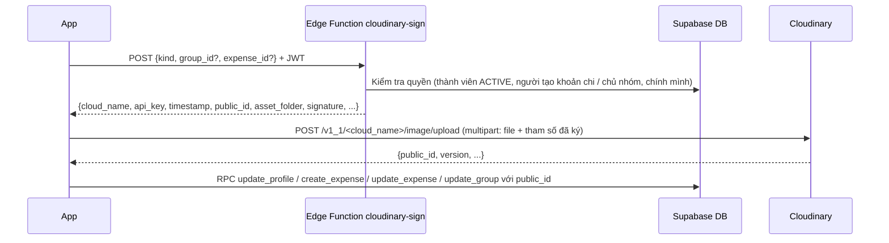

# Việc còn thiếu cho MVP — Split Bill App

22/10/2026 · Đối chiếu code trên `master` (commit `fcc3e17`) với [BA v1.1](BA_SplitBill_TatToanCongNo_v1.1.md) và [kế hoạch code v2.0](DEV_SplitBill_KeHoachCode_v2.0.md)

## 1. Tóm tắt

Phần lõi của MVP đã chạy: tài khoản, nhóm, mời bằng link/mã, khoản chi 3 cách chia, công nợ và gợi ý tất toán, thanh toán và xác nhận, thông báo, lịch sử, mất mạng. Còn **9 việc** để đủ MVP theo spec. Ba việc liên quan ảnh (ảnh hóa đơn, ảnh đại diện, ảnh nhóm) đề xuất chuyển sang **Cloudinary** theo mục 4.

| Mã | Việc | Spec | Độ lớn | Phụ thuộc |
| --- | --- | --- | --- | --- |
| MVP-01 | Ảnh hóa đơn | EXP-08 | M | MVP-00 (Cloudinary) |
| MVP-02 | Ảnh đại diện người dùng | ACC-02 | S | MVP-00 |
| MVP-03 | Tạo nhóm đầy đủ (mô tả, ảnh nhóm, công tắc đơn giản hóa) | GRP-03, BR-09 | M | MVP-00 cho ảnh nhóm |
| MVP-04 | QR mời vào nhóm + quét QR | GRP-04 | M | Development build |
| MVP-05 | QR kết bạn + quét | CON-02 | S | MVP-04 (dùng chung màn quét) |
| MVP-06 | Mời bạn bè vào nhóm từ danh sách bạn | DEV giai đoạn 7 | M | — |
| MVP-07 | Màn phương thức thanh toán + hiện trong gợi ý tất toán | DEV §3.1, BA §8 rủi ro 3 | M | — |
| MVP-08 | Đổi mã mời nhóm, mời lại người đã bị xóa | YC GRP-02, BE-07 | S | — |
| MVP-09 | Home lọc theo thời gian | HOME-01 | S | — |
| MVP-00 | Hạ tầng upload Cloudinary (Edge Function ký, hàm dùng chung trong app) | — | M | Tài khoản Cloudinary |

Độ lớn: S ≈ 0,5–1 ngày, M ≈ 1–3 ngày cho một dev, chưa tính kiểm thử trên máy thật.

**Không cần làm thêm cho MVP:** thông báo khi gợi ý thay đổi. AC-03.2 (bị từ chối thì người gửi được báo) đã có qua `PAYMENT_REJECTED`; AC-06.1 (hủy khoản chi thì các thành viên được báo) đã có qua `EXPENSE_CANCELLED`. Thông báo riêng loại "gợi ý của bạn thay đổi" chờ Product Owner chốt câu hỏi mở ở BA §8 ("mỗi lần thay đổi hay chỉ khi số tiền phải trả tăng").

**Ngoài MVP:** đọc hóa đơn bằng AI (OCR-01 đến OCR-09), Realtime, thêm khoản chi hai bước (hiện là một màn, chạy đúng nghiệp vụ).

**Lưu ý chung:** MVP-01, 02, 03, 04, 05 cần thư viện có mã native (`expo-image-picker`, `expo-camera`). Từ đó app không chạy trên Expo Go, phải dùng development build (`eas build --profile development`) hoặc APK `preview`. Cài thư viện bằng `npx expo install <tên>` để đúng phiên bản SDK 58.

## 2. Chi tiết từng việc

### MVP-01 — Ảnh hóa đơn (EXP-08)

| Mục | Nội dung |
| --- | --- |
| Hiện trạng | DB có `expenses.receipt_path`; RPC `create_expense`, `update_expense` nhận `_receipt_path` (bắt buộc bắt đầu bằng `<group_id>/`). Bucket Supabase `receipts` và policy đã có nhưng app chưa có nút chọn ảnh |
| App | Nút "Thêm ảnh hóa đơn" ở màn thêm và sửa khoản chi: chụp hoặc chọn ảnh (`expo-image-picker`), nén bằng `expo-image-manipulator` (cạnh dài ≤ 1600 px, JPEG 0,7), upload theo mục 4, lưu `public_id` vào `receipt_path`. Màn chi tiết khoản chi hiện ảnh thu nhỏ, chạm để xem lớn |
| Mất mạng | Lưu ảnh tạm trên máy, đưa thao tác upload vào hàng đợi trước `create_expense`; khoản chi vẫn lưu được không kèm ảnh |
| Quyền | Chỉ thành viên ACTIVE (và LEFT tới lúc rời) xem được ảnh của nhóm; chỉ người tạo khoản chi hoặc chủ nhóm thay, xóa ảnh — giữ nguyên quy tắc SEC-09 |
| Xong khi | Thêm, thay, xóa ảnh hóa đơn trên Android thật; người ngoài nhóm không mở được ảnh dù có đường dẫn (nếu chọn phương án riêng tư ở 4.3) |

### MVP-02 — Ảnh đại diện (ACC-02)

| Mục | Nội dung |
| --- | --- |
| Hiện trạng | `api/profiles.ts` có `uploadAvatar`, `deleteAvatar` (Supabase Storage `avatars`) nhưng không màn nào gọi; RPC `update_profile` nhận `_avatar_path` (bắt đầu bằng `<user_id>/`) và `_clear_avatar` |
| App | Màn Hồ sơ: chạm ảnh để chọn, xem trước, lưu; nút xóa ảnh. Hiện ảnh ở Tài khoản, danh sách thành viên, hồ sơ công khai, danh bạ (thay chữ cái đầu khi có ảnh) |
| Backend | Đổi `uploadAvatar` sang Cloudinary (mục 4); `delete-account` xóa ảnh trên Cloudinary khi ẩn danh tài khoản |
| Xong khi | Đổi ảnh xong, người chung nhóm thấy ảnh mới; xóa tài khoản thì ảnh bị xóa khỏi Cloudinary |

### MVP-03 — Tạo nhóm đầy đủ (GRP-03, BR-09)

| Mục | Nội dung |
| --- | --- |
| Hiện trạng | Tạo nhóm là hộp thoại chỉ nhập tên (`groups.tsx`); RPC `create_group(_name)`. Mô tả và công tắc chỉ sửa được sau khi tạo |
| Backend | Migration `0012`: thêm tham số `_description`, `_simplify_debts DEFAULT true`, `_avatar_path` cho `create_group` (bỏ hàm cũ một tham số, cấp lại quyền như 0010); `update_group` nhận `_avatar_path` (bắt đầu bằng `<group_id>/`) |
| App | Màn `group/new.tsx` thay hộp thoại: tên, mô tả, ảnh nhóm, công tắc "Đơn giản hóa công nợ" (mặc định bật, kèm một câu giải thích); màn sửa nhóm thêm đổi ảnh |
| Xong khi | Tạo nhóm với công tắc tắt → màn công nợ hiện chế độ theo cặp ngay (AC-05.1) |

### MVP-04 — QR mời vào nhóm + quét QR (GRP-04)

| Mục | Nội dung |
| --- | --- |
| Hiện trạng | `group/[id]/invite.tsx` tạo link mời `Linking.createURL('/join/<token>')` và mã mời; chưa có QR |
| Thư viện | `react-native-qrcode-svg` (cần `react-native-svg`), `expo-camera` |
| App | Màn mời hiện QR chứa link mời (có hạn, số lần dùng theo lời mời). Màn quét chung `scan.tsx` (nút ở tab Nhóm và Danh bạ): xin quyền camera, đọc QR, **chỉ chấp nhận link có scheme `splitbill://` của app** rồi điều hướng nội bộ; QR lạ thì báo "Mã QR không phải của Split Bill" và không mở trình duyệt |
| Cấu hình | `app.json`: plugin `expo-camera` với câu xin quyền tiếng Việt |
| Xong khi | Máy A hiện QR, máy B quét → vào đúng nhóm; QR hết hạn hoặc đã thu hồi → báo lỗi đúng (`INVITE_EXPIRED`, `INVITE_REVOKED`) |

### MVP-05 — QR kết bạn (CON-02)

| Mục | Nội dung |
| --- | --- |
| Hiện trạng | `contacts/add.tsx:152` chỉ có ô giữ chỗ "QR Code"; tìm bạn theo tên hoặc `user_code` đã chạy (`search_users`) |
| App | Hiện QR chứa `splitbill://add-friend/<user_code>`; màn quét (MVP-04) nhận dạng link này → tìm theo `user_code` → mở hồ sơ công khai để gửi lời mời |
| Quyền riêng tư | Người tắt `searchable` vẫn tự cho người khác quét QR của mình được — cần RPC `find_user_by_code(_code)` trả 4 cột công khai, không lọc `searchable` khi khớp chính xác mã (khác tìm kiếm theo tên). Cần Product Owner xác nhận quy tắc này |
| Xong khi | Quét QR → gửi lời mời kết bạn → bên kia chấp nhận |

### MVP-06 — Mời bạn bè vào nhóm từ danh sách bạn

| Mục | Nội dung |
| --- | --- |
| Hiện trạng | RPC `create_invite` có `_invited_user_id` (mời đích danh) nhưng không tạo thông báo cho người được mời; app chưa có giao diện |
| Backend | Migration `0012`: `create_invite` tạo thông báo `GROUP_INVITED` (kèm token) cho người được mời; thêm nội dung push tiếng Việt cho loại này trong `send-push` |
| App | Màn mời: danh sách bạn bè chưa ở trong nhóm, nút "Mời". Màn Thông báo: chạm `GROUP_INVITED` → mở `join/[token]` để chấp nhận |
| Xong khi | A mời B từ danh sách bạn → B nhận push → chạm → vào nhóm |

### MVP-07 — Phương thức thanh toán

| Mục | Nội dung |
| --- | --- |
| Hiện trạng | Bảng `payment_handles` (BANK / EWALLET / OTHER, `display_text`), API `fetchPaymentHandles`, policy cho chính mình, người chung nhóm, bạn bè; chỉ hiện ở hồ sơ bạn bè |
| App | Màn `account/payment-methods.tsx`: thêm, sửa, xóa (loại + nội dung, ví dụ "Vietcombank 0123… — NGUYEN VAN A"). Màn gợi ý tất toán và màn thanh toán hiện phương thức của người nhận, có nút sao chép |
| Dữ liệu cá nhân | Số tài khoản là thông tin cá nhân: chỉ hiện cho người chung nhóm hoặc bạn bè (đã có policy), không ghi vào log, cảnh báo người dùng không nhập mật khẩu hay mã OTP |
| Xong khi | B thấy phương thức của A ngay trong gợi ý "Chuyển A 45.000đ" |

### MVP-08 — Đổi mã mời, mời lại người đã bị xóa

| Mục | Nội dung |
| --- | --- |
| Hiện trạng | Backend đã có `rotate_invite_code` và cho người bị xóa vào lại qua lời mời đích danh của chủ nhóm (0010, 0011); app chưa có nút |
| App | Màn mời: nút "Đổi mã mời" (chỉ chủ nhóm, có hỏi lại). Màn thành viên: mục "Đã bị xóa" với nút "Mời lại" (tạo lời mời đích danh, dùng luồng MVP-06) |
| Xong khi | Đổi mã → mã cũ báo `INVITE_CODE_NOT_FOUND`; người bị xóa chỉ vào lại được qua lời mời của chủ nhóm |

### MVP-09 — Home lọc theo thời gian (HOME-01)

| Mục | Nội dung |
| --- | --- |
| App | Bộ lọc "7 ngày / 30 ngày / Tháng này / Tất cả" cho "Giao dịch gần đây" trên Home. Tổng cần thu, cần trả vẫn là số dư chính thức hiện tại, không đổi theo bộ lọc (BR-10) |
| Xong khi | Đổi bộ lọc → danh sách đổi, tổng không đổi |

## 3. Thứ tự đề xuất

1. **MVP-00** hạ tầng Cloudinary → **MVP-02** ảnh đại diện (đơn giản nhất, kiểm chứng luồng upload) → **MVP-01** ảnh hóa đơn → **MVP-03** tạo nhóm đầy đủ.
2. **MVP-04** → **MVP-05** (dùng chung màn quét và development build).
3. **MVP-06** → **MVP-08** (dùng chung lời mời đích danh và migration 0012).
4. **MVP-07**, **MVP-09** làm song song bất kỳ lúc nào.

Gom mọi thay đổi DB vào một migration `0012_mvp_features.sql`, viết theo kiểu chạy lại được như 0011, kèm test pgTAP.

## 4. Upload ảnh lên Cloudinary (MVP-00)

### 4.1. Nguyên tắc

- **API secret của Cloudinary chỉ nằm trong Edge Function** (secret của Supabase), không bao giờ ở app. Mọi biến `EXPO_PUBLIC_*` đều bị đóng gói vào app và đọc được.
- **Không dùng upload preset "unsigned"** cho app thật: ai có tên preset cũng upload được vào tài khoản Cloudinary. Dùng **upload có chữ ký** do server cấp cho từng lần upload.
- Supabase vẫn là nơi quyết định quyền: Edge Function kiểm tra người gọi trước khi ký.
- Trong DB chỉ lưu `public_id` của Cloudinary (vào `avatar_path`, `receipt_path`, `groups.avatar_path`), không lưu URL đầy đủ. Đặt `public_id` theo đúng quy tắc tiền tố mà RPC đang kiểm tra để không phải đổi schema:

| Loại ảnh | `public_id` | Cột | Quy tắc RPC hiện có |
| --- | --- | --- | --- |
| Ảnh đại diện | `<user_id>/avatar_<timestamp>` | `profiles.avatar_path` | Bắt đầu bằng `<user_id>/` |
| Ảnh hóa đơn | `<group_id>/<expense_id hoặc uuid tạm>/<uuid>` | `expenses.receipt_path` | Bắt đầu bằng `<group_id>/` |
| Ảnh nhóm | `<group_id>/group_<timestamp>` | `groups.avatar_path` | Thêm ở 0012 |

Dùng thêm tham số `asset_folder` (ví dụ `splitbill/avatars`, `splitbill/receipts`, `splitbill/groups`) để sắp xếp trong Media Library mà không ảnh hưởng `public_id`.

### 4.2. Luồng upload

**Edge Function `cloudinary-sign` (mới):**

1. Xác thực JWT bằng `auth.getUser` (như `settlements`).
2. Theo `kind`:
   - `avatar`: chỉ cho chính người gọi.
   - `receipt`: người gọi là thành viên ACTIVE của nhóm đang ACTIVE; nếu đã có `expense_id` thì phải là người tạo khoản chi hoặc chủ nhóm (cùng quy tắc SEC-09).
   - `group`: chỉ chủ nhóm.
3. Tự đặt `public_id`, `asset_folder`, `timestamp`, giới hạn định dạng (`allowed_formats=jpg,png,webp,heic`) — app không được tự chọn `public_id`.
4. Ký các tham số bằng `api_secret` theo cách Cloudinary quy định (sắp xếp tham số, nối `api_secret`, băm SHA-1 hoặc SHA-256) và trả về chữ ký. Chữ ký chỉ có hiệu lực trong khoảng thời gian ngắn tính từ `timestamp`.
5. Secret: `npx supabase@latest secrets set --env-file <file ngoài repo>` với `CLOUDINARY_CLOUD_NAME`, `CLOUDINARY_API_KEY`, `CLOUDINARY_API_SECRET` (dùng file để secret không nằm trong lịch sử lệnh; xóa file sau khi đặt).

**App (`src/api/images.ts` mới):** `uploadImage(kind, localUri, ids)` → nén ảnh → gọi `cloudinary-sign` → `fetch` multipart tới Cloudinary (trường `file` là `{ uri, name, type }`) → trả `public_id`. Hàm hiển thị `imageUrl(publicId, { width })` ghép URL kèm biến đổi `c_fill,w_<n>,f_auto,q_auto` để tải ảnh nhỏ, đúng định dạng máy.

**Xóa ảnh:** khi đổi ảnh đại diện, xóa ảnh cũ; khi xóa tài khoản (`delete-account`), xóa ảnh đại diện. Gọi API `destroy` của Cloudinary từ Edge Function (có chữ ký), không gọi từ app. Ảnh hóa đơn **không xóa** khi hủy khoản chi (nguyên tắc DEV §1.6: không xóa dữ liệu tài chính).

### 4.3. Ảnh hóa đơn là dữ liệu riêng tư — chọn một trong hai

Ảnh hóa đơn có thể chứa tên, số điện thoại, số thẻ in trên hóa đơn. BA yêu cầu chỉ thành viên nhóm xem được (bucket `receipts` riêng tư). Kiểu `upload` mặc định của Cloudinary là **URL công khai**: ai có link đều xem được.

| Phương án | Cách làm | Ưu | Nhược |
| --- | --- | --- | --- |
| **A (đề xuất)** | Ảnh đại diện, ảnh nhóm lên Cloudinary; **ảnh hóa đơn giữ Supabase Storage** `receipts` (đã có policy riêng tư theo nhóm, đã test) | Không đổi mô hình quyền; URL hóa đơn có hạn (signed URL của Supabase) | Hai nơi lưu ảnh |
| B | Mọi ảnh lên Cloudinary; hóa đơn upload kiểu `type=authenticated`; Edge Function chỉ cấp URL có chữ ký cho thành viên nhóm | Một nơi lưu ảnh, có biến đổi ảnh của Cloudinary | URL có chữ ký của kiểu `authenticated` không tự hết hạn: lộ link là lộ ảnh. URL có hạn dùng token xác thực của Cloudinary — cần kiểm tra gói đang dùng có hỗ trợ không trước khi chọn |

Nếu chọn B: thêm `kind=receipt_view` cho Edge Function để cấp URL xem, app không tự ghép URL hóa đơn.

### 4.4. Tuân thủ và vận hành

- **Dữ liệu cá nhân:** Cloudinary là bên thứ ba lưu ảnh người dùng. Cập nhật chính sách quyền riêng tư của app; tắt các tính năng AI tự động (nhận diện, gắn thẻ) trong tài khoản Cloudinary; không gửi ảnh hóa đơn tới dịch vụ AI (BR-15).
- **Hạn mức:** gói miễn phí giới hạn dung lượng, băng thông và số lần biến đổi ảnh — kiểm tra hạn mức hiện tại trên trang giá của Cloudinary trước khi phát hành; nén ảnh trước khi upload và dùng `f_auto,q_auto` khi hiển thị.
- **Dọn ảnh mồ côi:** ảnh đã upload nhưng không lưu khoản chi (người dùng thoát) sẽ thừa; lưu `public_id` tạm và chạy dọn định kỳ (ví dụ Edge Function theo lịch xóa ảnh trong `splitbill/receipts` không được khoản chi nào tham chiếu sau 24 giờ).
- **Dữ liệu cũ:** hiện chưa màn nào upload nên không có ảnh trên Supabase Storage cần chuyển; bucket `avatars` có thể giữ lại để tương thích.

### 4.5. Việc cần người dùng làm

1. Tạo tài khoản Cloudinary, lấy `cloud name`, `API key`, `API secret` (Dashboard → Settings → API Keys).
2. Chạy `npx supabase@latest secrets set --env-file <file>` với 3 giá trị trên (CLI chưa cài toàn cục nên phải qua `npx`). **Không** đưa vào `.env`, `eas.json` hay app.
3. Chọn phương án A hoặc B cho ảnh hóa đơn (mục 4.3).

## 5. Câu hỏi cần Product Owner chốt

- [ ] Ảnh hóa đơn: phương án A hay B (mục 4.3)?
- [ ] QR kết bạn có cho tìm người đã tắt `searchable` khi quét đúng mã của họ không (MVP-05)?
- [ ] Có cần thông báo riêng "gợi ý tất toán của bạn đã thay đổi" không, và gửi khi nào (BA §8)?
- [ ] Đọc hóa đơn bằng AI có vào đợt phát hành đầu không? Nếu có, ảnh hưởng thứ tự: OCR dùng chung luồng chọn ảnh của MVP-01.

## 6. Trạng thái sau khi làm — 23/10/2026

Đã làm đủ MVP-00 đến MVP-09 theo phương án A (ảnh đại diện, ảnh nhóm trên Cloudinary; ảnh hóa đơn trên Supabase Storage `receipts`) và sửa các lỗi rà soát của bản làm dở (C1, H1–H5, M1–M7, L1–L8).

**Kiểm tra**

| Kiểm tra | Kết quả |
| --- | --- |
| `jest` | 160/160 pass, 13 bộ (thêm test đường dẫn hóa đơn, link QR, bộ lọc thời gian, kích thước ảnh) |
| `tsc --noEmit` | Sạch |
| `expo lint --max-warnings 0` | 0 lỗi, 0 cảnh báo |
| Test SQL (pgTAP) | 287/287 pass trên PostgreSQL 17 dựng tạm; 0001→0012, chạy 0012 lần hai không lỗi |
| Cloudinary thật, Deno, thiết bị thật | **Chưa chạy** |

**Thay đổi chính**

| Phần | Nội dung |
| --- | --- |
| Migration `0012_mvp_features.sql` | `create_group(_name, _description, _simplify_debts)` một lần gọi; `update_group(..., _avatar_path, _clear_avatar)`; `find_user_by_code`; `notifications.invite_id` + thông báo `GROUP_INVITED` khi mời đích danh; `accept_invite_by_id`; ràng buộc độ dài `payment_handles.display_text` 1–200 |
| `cloudinary-sign` | Chỉ ký `avatar`, `group` (bỏ `receipt`, bỏ `overwrite`); thêm `destroy` có kiểm tra quyền; báo `CONFIG_MISSING` khi thiếu secret |
| `delete-account` | Xóa mọi ảnh dưới `<uid>/` trên Cloudinary qua Admin API, kể cả khi chạy lại; lỗi thì trả 502 trước khi xóa tài khoản Auth |
| `send-push` | Nội dung cho `GROUP_INVITED`, kèm `invite_id` |
| App | Đường dẫn hóa đơn 3 cấp + `expo-crypto`; thêm/thay/xóa ảnh hóa đơn khi sửa; ảnh hóa đơn đi qua hàng đợi khi mất mạng; nén ảnh bằng API mới của SDK 58; ảnh đại diện hiện ở mọi màn, xóa ảnh cũ trên Cloudinary; tạo nhóm có ảnh; route `join-code/[code]`, `add-friend/[code]`; màn quét chỉ nhận link của app, có nút mở Cài đặt; chấp nhận lời mời từ thông báo; sửa phương thức thanh toán, cảnh báo OTP, hiện ở gợi ý và màn thanh toán kèm nút sao chép; bộ lọc thời gian trên Home (mặc định "Tất cả"); sửa chữ lỗi font |
| Thư viện mới | `expo-camera`, `expo-image-picker`, `expo-image-manipulator`, `expo-file-system`, `expo-clipboard`, `react-native-qrcode-svg`, `react-native-svg` |

**Còn lại**

| Mục | Ghi chú |
| --- | --- |
| Dọn ảnh hóa đơn mồ côi | Ảnh đã upload nhưng `create_expense` lỗi nghiệp vụ vẫn nằm trong Storage; cần Edge Function chạy định kỳ (mục 4.4) |
| Tên nhóm trong danh sách thông báo mời | Người được mời chưa đọc được bảng `groups` (RLS) nên danh sách thông báo không hiện tên nhóm; push vẫn có tên |
| Câu hỏi Product Owner (mục 5) | QR kết bạn hiện cho tìm người đã tắt `searchable` khi quét đúng mã — chờ xác nhận |

**Triển khai (theo thứ tự)**

1. `npx supabase@latest db push` (0012) — phải trước bước 2 vì `send-push` đọc cột `invite_id`.
2. `npx supabase@latest functions deploy` — deploy lại cả 4 hàm (3 hàm đang chạy là bản cũ trước vòng rà soát, `cloudinary-sign` chưa deploy).
3. Khai báo `EXPO_PUBLIC_CLOUDINARY_CLOUD_NAME` cho môi trường EAS (`npx eas-cli@latest env:create ... --environment preview --visibility plaintext`).
4. Build lại APK (`npx eas-cli@latest build -p android --profile preview`) — có thư viện native mới nên Expo Go và bản build cũ không dùng được.
